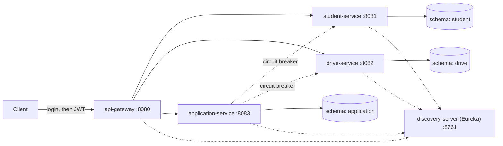

# Campus Placement Management System

A microservices backend that replaces the Excel sheets and WhatsApp groups a college placement cell uses today. Companies post drives with eligibility rules, students apply, and each application moves through interview rounds.

Built with **Spring Boot, Hibernate (JPA), PostgreSQL and Spring Cloud**.

## The problem

Placement cells track companies, eligibility and interview rounds by hand. Students miss deadlines, ineligible students apply by mistake, and nobody can see where an application stands. This system checks eligibility automatically (CGPA, backlogs, branch, graduation year) and keeps a full history of every application.

## Architecture



| Service | Port | Responsibility |
|---|---|---|
| discovery-server | 8761 | Eureka service registry |
| api-gateway | 8080 | Single entry point, JWT login, role checks, routing |
| student-service | 8081 | Students, CGPA, branch, backlogs |
| drive-service | 8082 | Companies, drives, eligibility rules |
| application-service | 8083 | Applications, round tracking, history |

Each service has its **own database schema** and never reads another service's tables. `application-service` stores only student and drive IDs and asks the other services over HTTP when it needs data.

## Engineering highlights

- **N+1 problem, reproduced and fixed.** `GET /drives/slow` runs one query for drives plus one per company. `GET /drives` loads everything in a single join using `@EntityGraph`. The SQL logs show both.
- **Optimistic locking.** `@Version` on entities, and a concurrent update returns HTTP 409 instead of silently overwriting.
- **Flyway migrations** with `ddl-auto: validate`, so the schema is versioned and Hibernate never alters it.
- **JPA auditing** (`@CreatedDate`, `@LastModifiedDate`) on every entity.
- **DTOs everywhere.** Entities are never returned from controllers.
- **Application history.** Every status change is stored as an event (`@OneToMany`), so the full path of an application can be shown.
- **Resilience.** Calls from `application-service` to the other services go through a Resilience4j circuit breaker. If a service is down, the client gets a clean 503 instead of a stack trace, and the breaker stops hammering the dead service.
- **Security at the gateway.** Login returns a signed JWT. The gateway validates it and enforces roles before routing.
- **Consistent errors.** `ProblemDetail` responses with proper status codes: 404, 409 (duplicate or concurrent update), 422 (not eligible), 503 (downstream unavailable).

## Roles

| Role | Can do |
|---|---|
| TPO (placement officer) | Everything: create companies and drives, advance or reject applications |
| STUDENT | Read data and apply to drives |

Demo logins: `tpo / tpo123` and `student1 / student123`.

## Run it locally

Requirements: Java 17+, Docker.

```powershell
# 1. Start Postgres (creates the three schemas)
docker compose up -d

# 2. Start Eureka first, then wait until http://localhost:8761 opens
cd discovery-server
.\mvnw spring-boot:run

# 3. In separate terminals, start each service
cd student-service      ; .\mvnw spring-boot:run
cd drive-service        ; .\mvnw spring-boot:run
cd application-service  ; .\mvnw spring-boot:run
cd api-gateway          ; .\mvnw spring-boot:run
```

On macOS or Linux use `./mvnw` instead of `.\mvnw`. Give the services about a minute to register in Eureka before sending requests.

## Try it

```powershell
# Log in as TPO
$tpo = Invoke-RestMethod -Method Post http://localhost:8080/auth/login -ContentType "application/json" -Body '{"username":"tpo","password":"tpo123"}'
$h = @{ Authorization = "Bearer $($tpo.token)" }

# Add a student, a company and a drive
Invoke-RestMethod -Method Post http://localhost:8080/students -Headers $h -ContentType "application/json" -Body '{"rollNo":"CE001","name":"Test Student","email":"test@example.com","branch":"COMPUTER","cgpa":8.3,"backlogs":0,"graduationYear":2027}'
Invoke-RestMethod -Method Post http://localhost:8080/companies -Headers $h -ContentType "application/json" -Body '{"name":"TCS","industry":"IT Services"}'
Invoke-RestMethod -Method Post http://localhost:8080/drives -Headers $h -ContentType "application/json" -Body '{"companyId":1,"role":"Software Engineer","packageLpa":7.5,"minCgpa":7.0,"maxBacklogs":0,"allowedBranches":"COMPUTER,IT","graduationYear":2027,"deadline":"2026-12-31"}'

# Apply, then move the application through the rounds
Invoke-RestMethod -Method Post http://localhost:8080/applications -Headers $h -ContentType "application/json" -Body '{"studentId":1,"driveId":1}'
Invoke-RestMethod -Method Patch http://localhost:8080/applications/1/advance -Headers $h
Invoke-RestMethod http://localhost:8080/applications/1 -Headers $h
```

Application status flow: `APPLIED -> APTITUDE -> TECHNICAL -> HR -> SELECTED`, and an application can be `REJECTED` at any stage before the end.

## Design notes and known limitations

- Service-to-service calls are synchronous with a circuit breaker. For a larger system I would move the notification and status events to Kafka.
- Passwords and the JWT secret in the config files are **demo values**. A real deployment would use a users table with hashed passwords and environment variables or a secrets manager.
- Services are still reachable directly on ports 8081 to 8083. In production they would sit on a private network behind the gateway.
- Automated tests and Dockerfiles for the services are the next planned additions.
